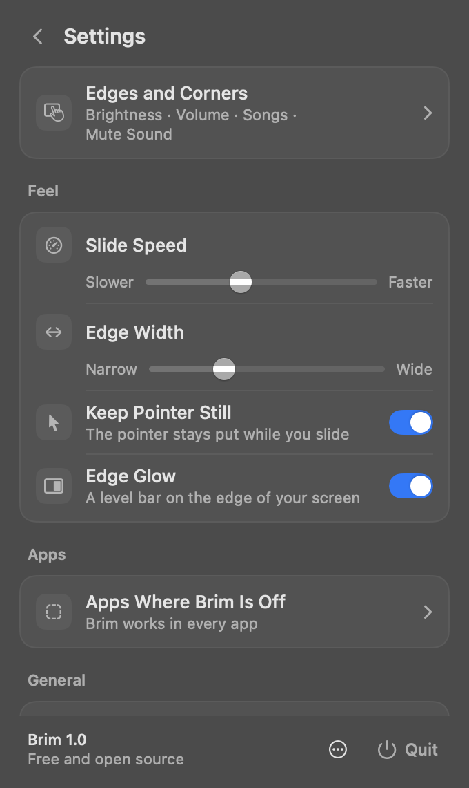

<p align="center"></p>

<h1 align="center">Brim</h1>
<p align="center"><b>Slide the edge.</b> Your Mac trackpad's edges become brightness and volume sliders.</p>

<p align="center">
  
  &nbsp;
  
</p>

## What it does

Out of the box:

| Gesture | Result |
| --- | --- |
| Slide along the **left edge** | Brightness up / down |
| Slide along the **right edge** | Volume up / down |
| **Swipe** along the bottom edge | Next / previous song |
| **Double-tap** the top-right corner | Mute / unmute |
| Hold **⇧⌥** while sliding | Quarter steps |

**Every edge and corner is configurable** (menu → Edges and Corners):

- **Edges** (left, right, top, bottom) can slide **Brightness, Volume, Keyboard Brightness, Microphone Volume, Night Shift Warmth**, step through **Tabs** or **Undo and Redo**, or be swiped for **Next/Previous Song** or **Switch Windows**. Top and bottom edges slide left and right.
- **Corners** (all four) respond to a double-tap: **Mute Sound, Mute Microphone, Play or Pause, Next Song, Previous Song, Keep Mac Awake, Lock Screen, Turn Off Display, Take a Screenshot, Spotlight, Emoji & Symbols, Run a Shortcut, or Open an App**.

Brim deliberately leaves out things macOS already does with multi-finger gestures (scrolling, zooming, switching desktops, back and forward, Mission Control).

Brightness, volume and keyboard brightness use the same on-screen display as the keyboard keys. Actions that press keys need Accessibility; Brim says so in place and offers to allow it.

**Menu:** live levels for the left and right edges (drag them, or adjust with VoiceOver), an on/off switch, "Use in [current app]", Edges and Corners, and haptic strength.

**Settings:** slide speed, edge width, keep pointer still, edge glow, apps where Brim is off, appearance, open at login, automatic updates; under Advanced: lower part of side edges only, palm rejection, only while holding Fn or Option, smaller steps with Shift-Option, restore defaults.

Also: accident protection (deliberate slides only, palms are caught and undone, quick straight swipes, double-taps in the same spot, nothing while typing or while the button is held), a first-run setup guide, per-app off switch, palm rejection, trackpad hot-plug, menu bar only (no Dock icon), and updates that download and install themselves.

## Build

Requires Xcode 15+ (Swift 5.9+). Runs on macOS 13 Ventura or later.

```sh
scripts/build.sh            # → build/Brim.app (universal, signed)
scripts/build.sh --dmg      # also build/Brim-1.0.dmg and website/Brim.dmg
scripts/build.sh --install  # also copy to /Applications and launch
swift test                  # gesture recognizer tests
```

Signing uses `$SIGN_IDENTITY`, or the first Apple Development / Developer ID identity in your keychain, or ad-hoc. Use a real identity if you can: macOS ties the Accessibility grant to the signature, so ad-hoc builds need re-granting after every rebuild.

On first launch, allow Brim in **System Settings → Privacy & Security → Accessibility**. Without it, Brim still changes volume and brightness directly, but there's no on-screen display and media keys won't work.

### Open source

Brim is free and open source. Set where the code lives so the app's ⋯ menu and the website can link to it:

```sh
SOURCE_URL=https://github.com/you/brim scripts/build.sh --dmg
```

and set `sourceURL` in `website/config.js`. Pick a license and add a `LICENSE` file before publishing.

### Releasing updates

```sh
WEBSITE_URL=https://your.site VERSION=1.1 NOTES="New thing|Fixed thing" scripts/build.sh --dmg
```

This writes `website/appcast.json` and `website/downloads/Brim-1.1.dmg`. Upload `website/` and every installed copy finds the update within 12 hours. Brim checks the DMG's SHA-256 and that the new app is signed by the same team, swaps itself and relaunches. Set the version, source link and contact email in `website/config.js`.

### Handy flags

```sh
build/Brim.app/Contents/MacOS/Brim --selftest            # checks trackpad, keys, brightness, haptics (restores levels)
build/Brim.app/Contents/MacOS/Brim --snapshot out/ dark  # renders menu, settings and setup screens to PNG
build/Brim.app/Contents/MacOS/Brim --simulate            # drives the gesture engine with fake fingers (restores every level)
open -n -W build/Brim.app --args --check-keys             # live check of Undo, Tabs and Windows in Brim's own test windows
```

## How it works

```
Sources/
  CBrimPrivate/        C shim, loads private frameworks at runtime (dlopen):
                         MultitouchSupport  raw finger positions + Force Touch actuator
                         DisplayServices    read / set built-in display brightness
  BrimCore/            EdgeRecognizer: pure gesture logic (frames in → actions out), unit tested
  Brim/
    EdgeEngine.swift   runs the recognizer on each trackpad frame and performs actions
    SystemControls     media key events, CoreAudio volume/mute, brightness
    Haptics.swift      actuator ticks, falls back to NSHapticFeedbackManager
    Prefs.swift        settings (UserDefaults) + Open at Login (SMAppService)
    Config.swift       build-time settings from Info.plist (AppConfig)
    Updater.swift      update feed check, download, verify, swap and relaunch
    BrandArt.swift     the app icon and menu bar glyph, drawn in code
    Functions.swift    what edges and corners can do (EdgeFunction, CornerFunction)
    KeyboardBacklight  keyboard backlight level (CoreBrightness)
    Views/             SwiftUI menu, Edges and Corners map, settings, setup guide
scripts/
  build.sh             build, bundle, sign, DMG, appcast.json
  IconTool/            renders BrandArt's icon to AppIcon.icns
website/               landing page with an interactive trackpad demo, terms, privacy
```

Gestures only start when a single finger **lands** in an edge zone, so moving the pointer into an edge never triggers anything. A slide is cancelled if the finger moves sideways first, or if a second finger lands before it starts (a scroll).

## Name and icon

**Brim**: the edge of something, as in "filled to the brim". The icon is a trackpad on a midnight tile with a warm brightness edge, a cool volume edge, and a glowing fingertip riding the volume edge.
