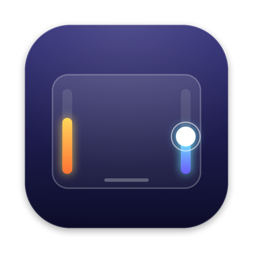
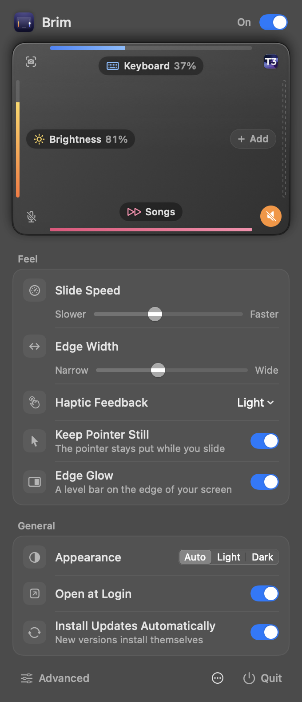
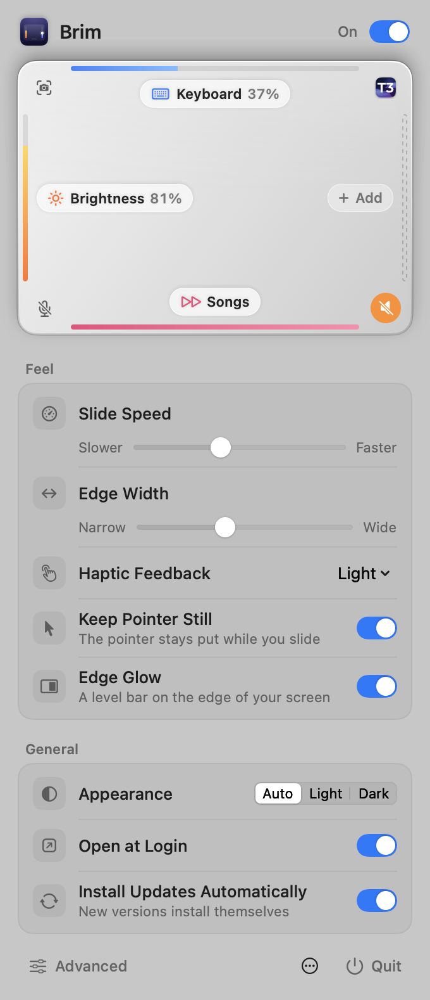

<p align="center"></p>

<h1 align="center">Brim</h1>

<p align="center"><b>Slide the edge.</b> Brim turns the edges of your Mac trackpad into volume and brightness sliders.</p>

<p align="center">
  <a href="https://github.com/hukpo/brim/releases/latest/download/Brim.dmg"><b>Download for Mac</b></a> ·
  <a href="https://hukpo.github.io/brim/">Website</a> ·
  <a href="#build-from-source">Build from source</a>
</p>

<p align="center">
  <a href="https://github.com/hukpo/brim/actions/workflows/ci.yml"></a>
  <a href="https://github.com/hukpo/brim/releases/latest"></a>
  
  <a href="LICENSE"></a>
</p>

<p align="center">
  
  &nbsp;
  
</p>

## What it does

Out of the box:

| Gesture | Result |
| --- | --- |
| Slide along the **left edge** | Brightness up or down |
| Slide along the **right edge** | Volume up or down |
| **Swipe** along the bottom edge | Next or previous song |
| **Double-tap** the top-right corner | Mute or unmute |
| Hold **⇧⌥** while sliding | Smaller steps |

Click any edge or corner on the trackpad in Brim's menu to change what it does:

- **Edges** slide **Brightness, Volume, Keyboard Brightness, Microphone Volume** or **Night Shift Warmth**, step through **Tabs** or **Undo and Redo**, or swipe for **Next/Previous Song** or **Switch Windows**.
- **Corners** respond to a double-tap: **Mute Sound, Mute Microphone, Play or Pause, Next Song, Previous Song, Keep Mac Awake, Lock Screen, Turn Off Display, Take a Screenshot, Spotlight, Emoji & Symbols, Run a Shortcut** or **Open an App**.

Brim leaves out what macOS already does with multi-finger gestures (scrolling, zooming, switching desktops, Mission Control).

**It feels right:**
- Haptic ticks under your finger.
- The same on-screen display as the keyboard keys.
- An optional glow on the screen edge.
- The pointer stays still while you slide.

**It stays out of your way:**
- It only responds to a deliberate slide that starts on an edge.
- Palms are caught and their changes undone.
- Nothing happens while you type or hold the trackpad button.
- It lives in the menu bar only, with no Dock icon.

## Install

1. [Download Brim](https://github.com/hukpo/brim/releases/latest/download/Brim.dmg), open it and drag Brim into Applications.
2. Open Brim. If macOS says it can't check Brim for malicious software, open **System Settings → Privacy & Security**, scroll down and click **Open Anyway**.
3. Slide up the right edge of your trackpad. The volume goes up.

Allowing **Accessibility** is optional. Without it, Brim still changes volume and brightness directly. With it, Brim shows the usual on-screen display and can press media keys for you. Brim never reads your screen or what you type.

It needs macOS 13 Ventura or later and runs on Apple silicon and Intel Macs, with built-in trackpads or a Magic Trackpad.

## Build from source

You need Xcode 15 or later (Swift 5.9+).

```sh
git clone https://github.com/hukpo/brim.git && cd brim
swift test                  # gesture recognizer tests
scripts/build.sh            # build/Brim.app (universal, signed)
scripts/build.sh --install  # also copies it to /Applications and launches it
```

Signing uses `$SIGN_IDENTITY`, or else the first Apple Development or Developer ID identity in your keychain, or else ad-hoc. A real identity is better, because macOS ties the Accessibility permission to the signature. With ad-hoc signing you have to allow Accessibility again after every rebuild.

### Checks and screenshots

```sh
build/Brim.app/Contents/MacOS/Brim --selftest            # trackpad, keys, brightness and haptics (restores your levels)
build/Brim.app/Contents/MacOS/Brim --simulate            # drives the gesture engine with fake fingers (restores your levels)
build/Brim.app/Contents/MacOS/Brim --snapshot out/ dark  # renders the menu, Advanced page and setup window to PNG
open -n -W build/Brim.app --args --check-keys            # live check of Undo, Tabs and Windows in Brim's own test windows
```

### Releasing

```sh
VERSION=1.1 NOTES="New thing|Fixed thing" scripts/build.sh --dmg
gh release create v1.1 build/Brim-1.1.dmg build/Brim.dmg --title "Brim 1.1"
git add website/appcast.json && git commit -m "Release 1.1" && git push
```

`--dmg` writes `website/appcast.json`, which points at the release's DMG. Once the website redeploys, every installed copy finds the update within 12 hours. Before it swaps itself and relaunches, Brim checks that the download's SHA-256 matches and that the new app is signed by the same team.

Forks can set `SOURCE_URL` and `WEBSITE_URL` to their own repository and site.

## How it works

```
Sources/
  CBrimPrivate/        C shim that loads private frameworks at runtime (dlopen):
                         MultitouchSupport  raw finger positions and the Force Touch actuator
                         DisplayServices    built-in display brightness
  BrimCore/            EdgeRecognizer: pure gesture logic (touch frames in, actions out), unit tested
  Brim/
    EdgeEngine.swift   runs the recognizer on every trackpad frame and performs the actions
    SystemControls     media keys, CoreAudio volume and mute, brightness
    Haptics.swift      actuator ticks, with NSHapticFeedbackManager as a fallback
    Functions.swift    what edges and corners can do
    Prefs.swift        settings (UserDefaults) and Open at Login (SMAppService)
    Updater.swift      update check, download, verification, swap and relaunch
    BrandArt.swift     the app icon and menu bar glyph, drawn in code
    Views/             the menu (trackpad map and settings), Advanced page, setup guide
scripts/
  build.sh             build, bundle, sign, DMG and appcast.json
  IconTool/            renders BrandArt's icon to AppIcon.icns
website/               the site at hukpo.github.io/brim, with an interactive trackpad demo
```

A gesture only starts when one finger lands in an edge zone, so moving the pointer to the edge of the trackpad never triggers anything. A slide is cancelled if the finger moves sideways first, if a second finger lands soon after (a scroll), or if the touch turns out to be a palm. In that last case the change is undone.

Brim reads touches through Apple's private MultitouchSupport framework, the same one the system uses. A future macOS update could change it.

## Privacy

There are no accounts, analytics or ads. Touches are handled in memory and never leave your Mac. The only network request is the optional update check, which downloads one small JSON file. See the [privacy page](https://hukpo.github.io/brim/privacy.html).

## Contributing

Bug reports, ideas and pull requests are welcome. See [CONTRIBUTING.md](CONTRIBUTING.md). If Brim makes your day a little smoother, a ⭐ helps other Mac users find it.

## License

[MIT](LICENSE) © 2026 Pavlo Huk. Mac and macOS are trademarks of Apple Inc.
